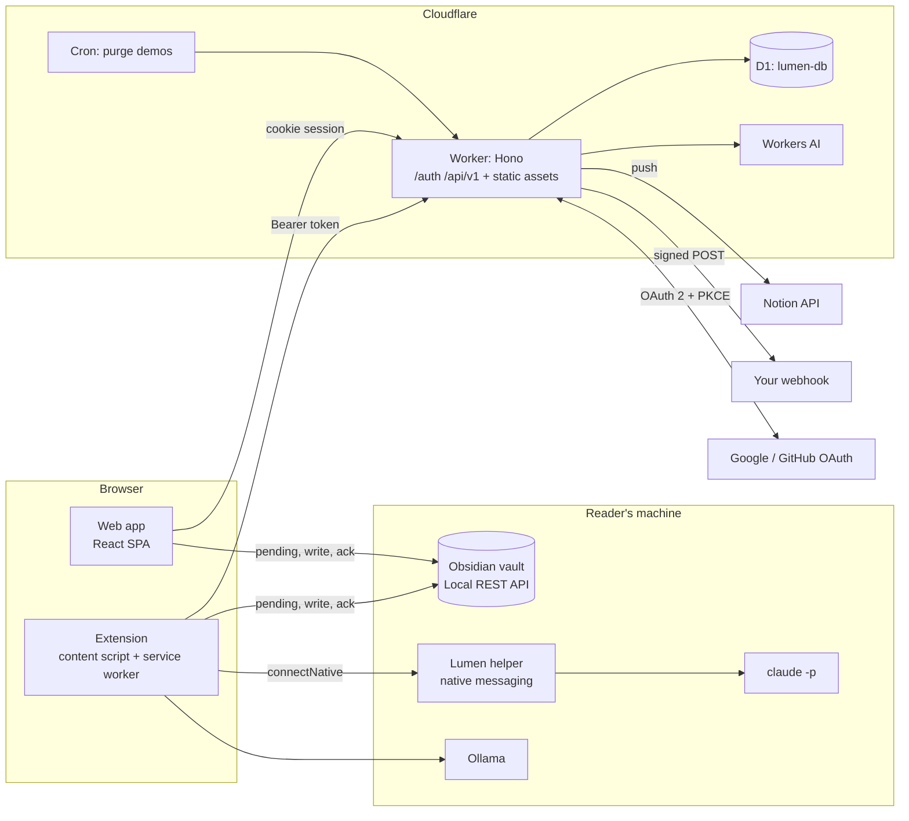
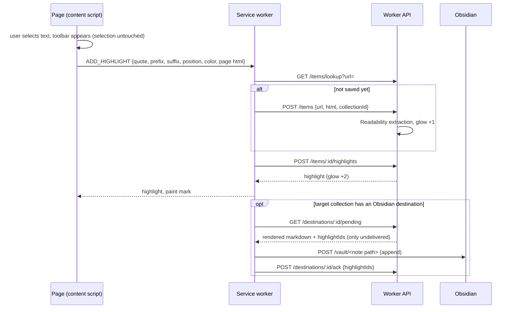
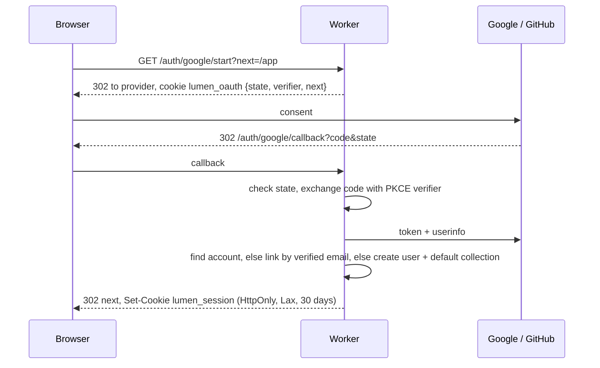

# Architecture

One Cloudflare Worker serves the web app, the API and the auth flows. D1 stores everything,
Workers AI answers margin questions, and the browser extension talks to the same API with a
personal access token. Obsidian is written from the reader's own machine.



## Repository layout

```
packages/core      shared types, anchoring, citation, markdown formats, glow rules, prompts
apps/web           Worker API (src/worker) + React SPA (src/client) + D1 migrations
apps/extension     WXT Manifest V3 extension (content, background, popup, options)
apps/native-host   Node helper that runs claude -p for the extension
docs               plan, architecture, states, API, data model, deploy
```

`@lumen/core` is imported as TypeScript source by every app, so the highlight anchoring, the
citation format and the markdown written to destinations are identical everywhere.
`@lumen/core/dom` holds the DOM parts and is never imported by the Worker.

## Key decisions

| Decision | Why |
|---|---|
| One Worker with static assets, not Pages + Functions | One deploy, one origin (so the session cookie is first party), `run_worker_first` for `/api` and `/auth` only |
| D1 with plain SQL, no ORM | Small schema, batch writes, keyset pagination; nothing to generate |
| Sessions in D1, token hashed | Cookie holds a random token; the database stores only its SHA-256, so a database leak does not leak sessions |
| Personal access tokens for the extension | Simple, revocable, scoped to one user; CORS allows only extension origins |
| CSRF: Origin check + `X-Lumen` header | Cookie writes must come from our origin; tokens are immune by design |
| Text quote selectors (quote + prefix + suffix + position) | Survives reflowed markup and works the same in the page, the reader and the server; a W3C Web Annotation model |
| Delivery ledger table | The `(highlight_id, destination_id)` primary key makes "append only new highlights" a database guarantee, idempotent on retries |
| Obsidian written client side | The vault lives on the reader's machine; the Local REST API key never reaches the server |
| Claude through native messaging | Extensions cannot spawn processes; the helper passes the prompt on stdin, never through a shell |
| Workers AI with daily quotas | No keys to manage for the default experience; heavy users switch to local models |
| Demo sandbox | Lets anyone explore the dashboard without SSO; rows cascade delete after 3 days via Cron |

## Request flows

### Save and highlight from the extension


### Sign in with SSO


## Security notes
- All rows carry `user_id`; every query filters by it. Foreign keys cascade on user delete.
- Article HTML is stored as extracted and sanitised with DOMPurify at render time.
- Webhooks are https only and signed with HMAC SHA-256 (`X-Lumen-Signature`).
- Notion tokens live in `destinations.secret` and are never returned by the API.
- Demo users cannot push to external services.
- The native helper only accepts `haiku`, `sonnet`, `opus` as models and passes text on stdin.

## Observability
Workers observability is on (`observability.enabled`). Errors are logged with context and
returned as `{ error: { code, message } }`; the client never sees stack traces.
