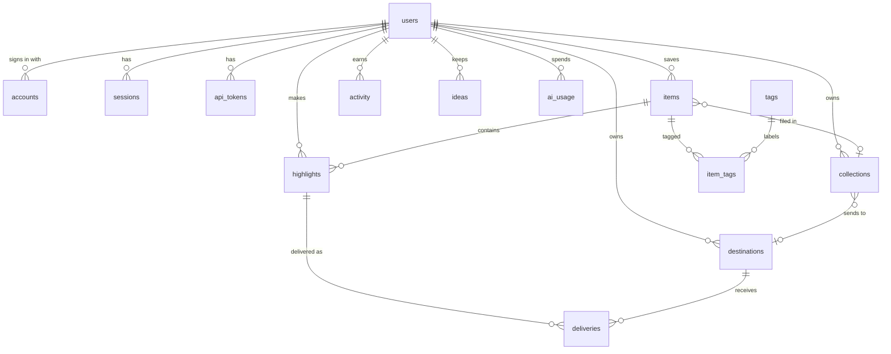

# Data model (D1)

| Table | Purpose | Notable columns and constraints |
|---|---|---|
| `users` | one reader | `is_demo`, `plan`, `daily_goal`, `timezone`, `ai_provider`; unique email when present |
| `accounts` | SSO identities | PK `(provider, provider_account_id)` |
| `sessions` | browser sessions | `id = sha256(token)`, `expires_at` |
| `api_tokens` | extension and script access | `token_hash` unique, `prefix` for display, `last_used_at` |
| `collections` | shelves per project | `destination_id` (nullable) |
| `items` | saved pages | unique `(user_id, url)`, `status`, `progress`, `content_html`, `content_text`, `reading_minutes` |
| `tags`, `item_tags` | free tagging | unique `(user_id, name)` |
| `highlights` | text quote selectors | `quote`, `prefix`, `suffix`, `position`, `color` (palette name or `#rrggbb`, see `packages/core/src/colors.ts`), `note` |
| `deliveries` | the ledger | PK `(highlight_id, destination_id)`, `status`, `attempts`, `error` |
| `activity` | glow ledger | `day` in the reader's time zone, `kind`, `glow` |
| `ideas` | Spark output | `outline` and `source_item_ids` as JSON |
| `ai_usage` | daily quota counter | PK `(user_id, day)`, upserted with `RETURNING count` |
| `topics` | what the radar watches | `source` auto or manual, `muted`; auto topics come from tags |
| `trends` | stories found per user | unique `(user_id, url)`, `score`, `comments`, `dismissed` |
| `radar_runs` | last refresh per user | refreshed every 6 hours by Cron or on view |
| `demo_creations` | demo abuse guard | hashed address, purged daily |

Added in migration 0002: `items.remind_after`, `items.last_opened_at`, `users.share_signals`,
`users.reminders`, `api_tokens.kind` (extension or agent) and `api_tokens.client`.

All foreign keys cascade from `users`, so deleting an account (or purging a demo) removes
everything in one statement. Migrations live in `apps/web/migrations`.
