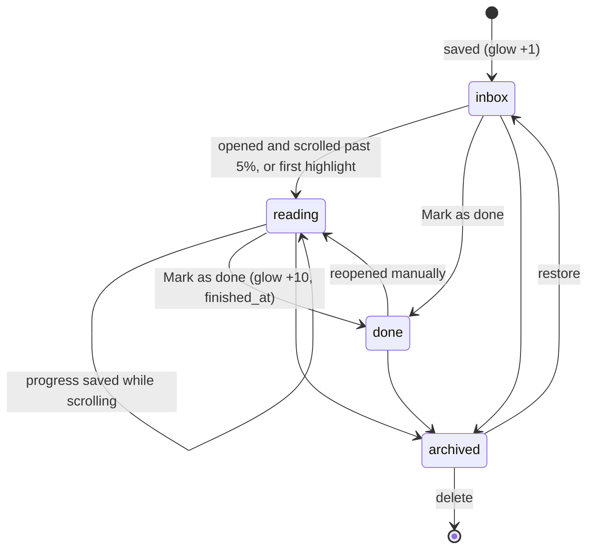
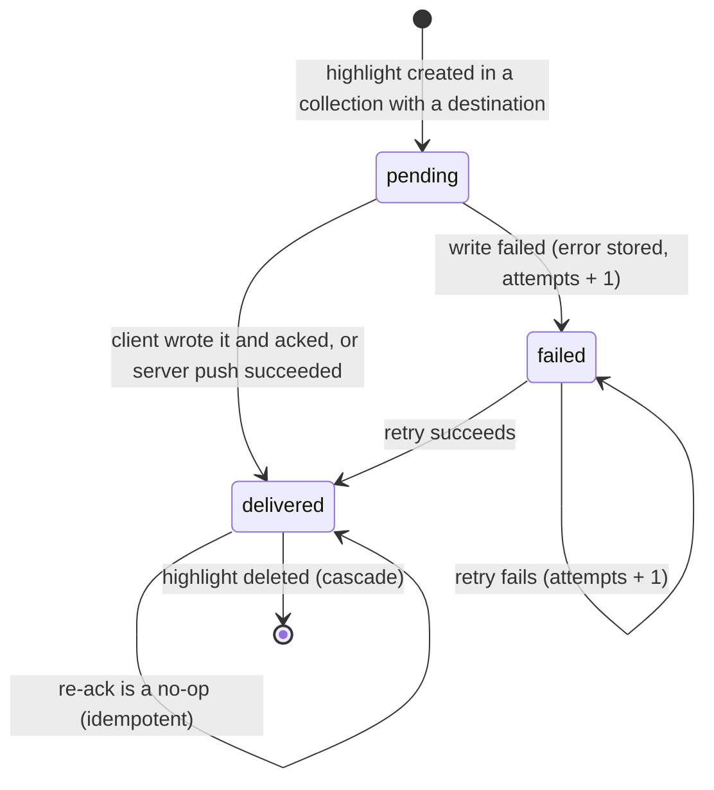
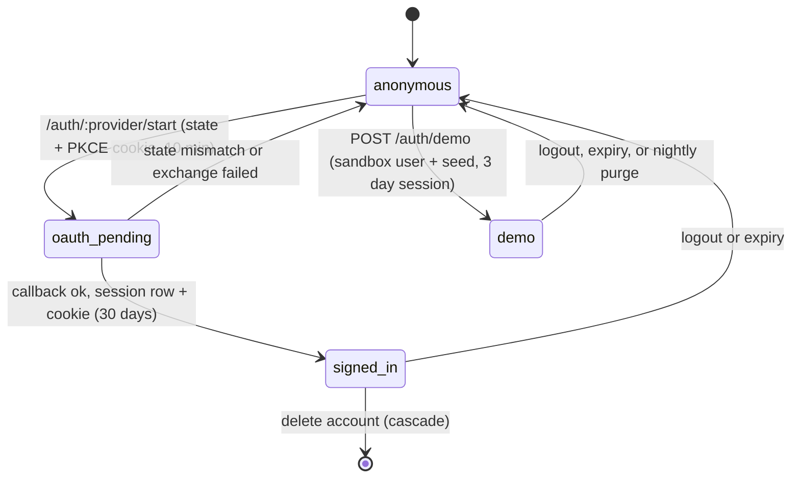
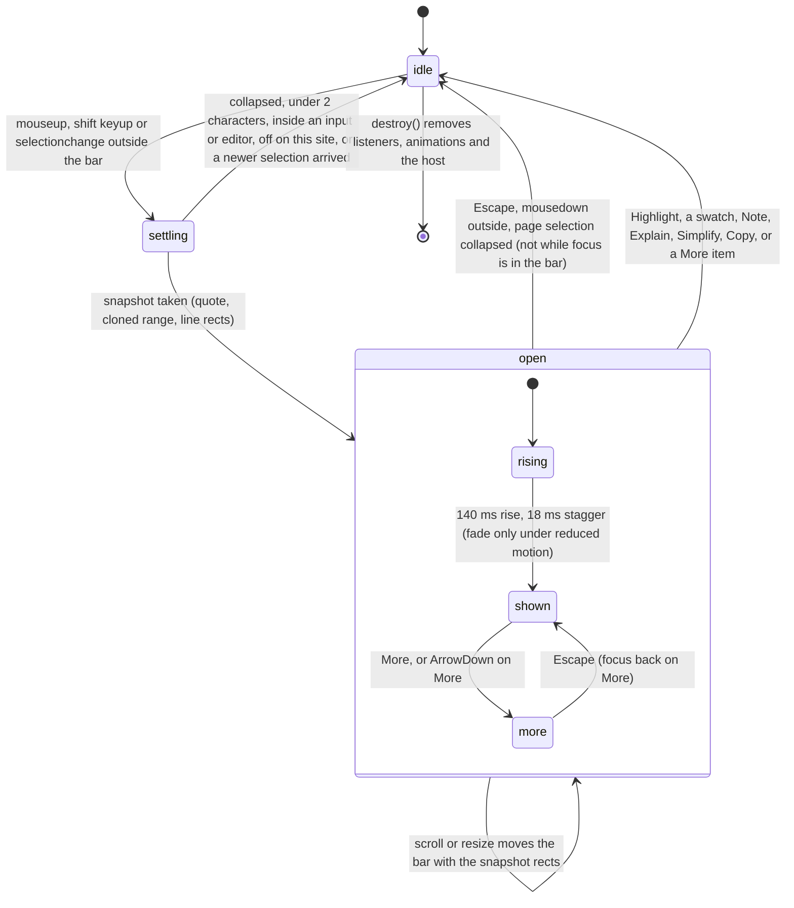
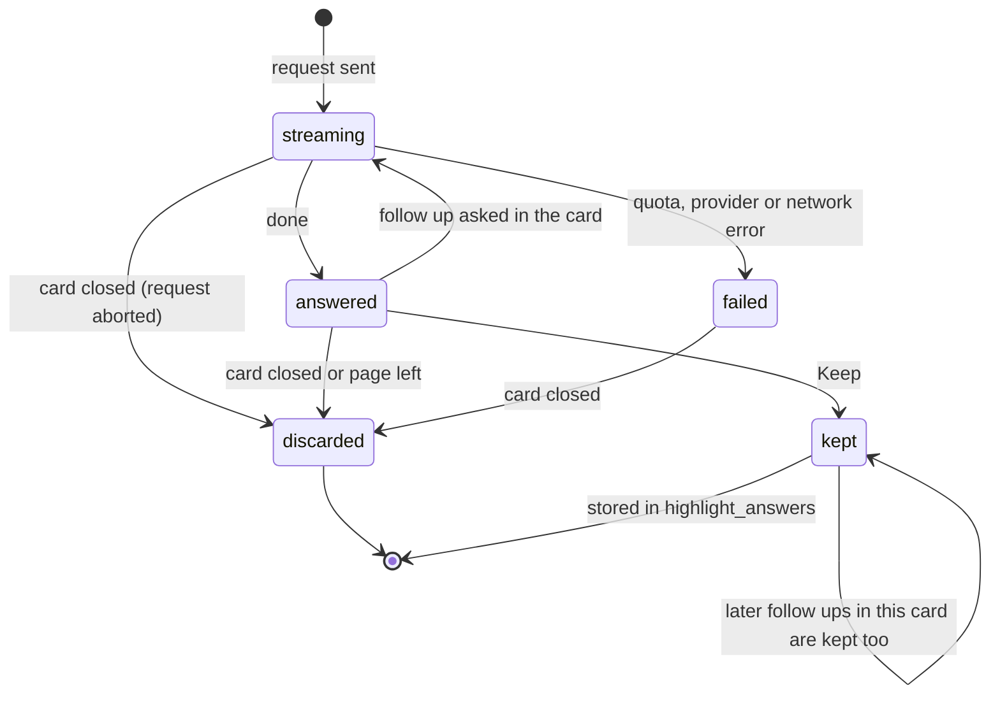
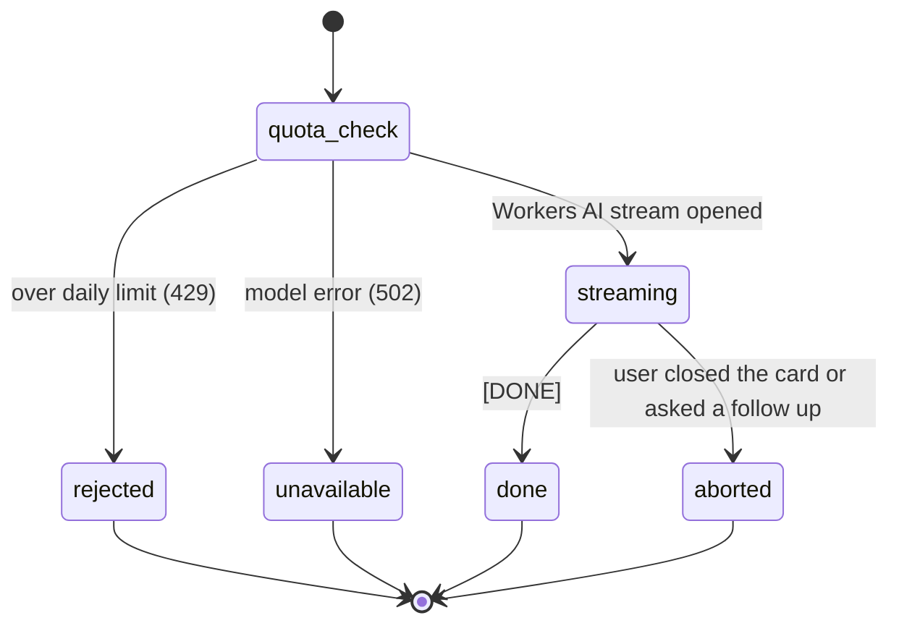
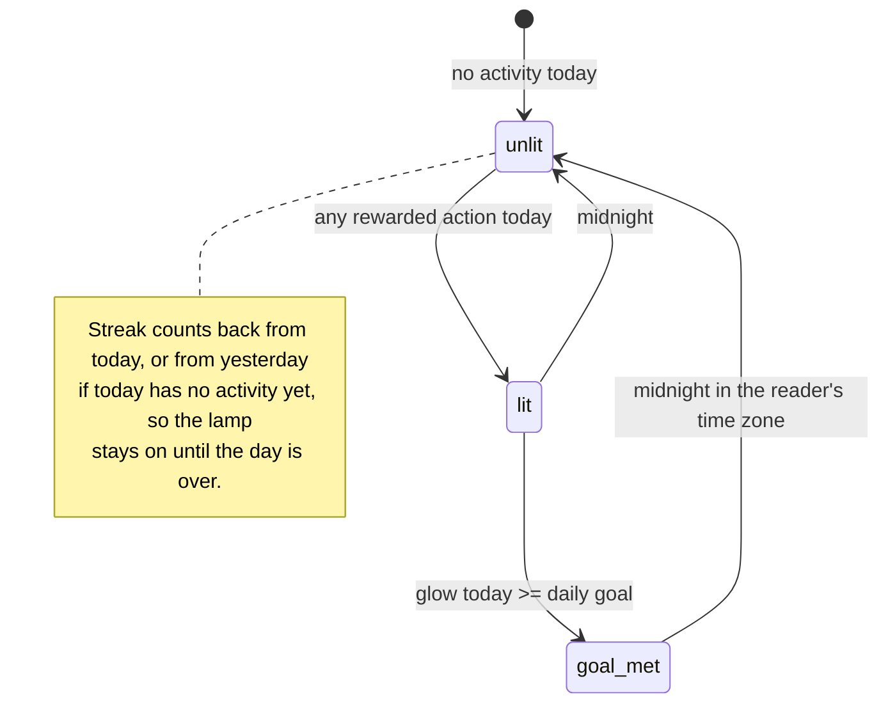

# State diagrams

## Item lifecycle

## Highlight delivery (per destination)
The ledger row is the only state. A highlight with no `delivered` row for a destination is pending.

Moving an item to a collection with a different destination makes its highlights pending for
that destination only; they stay delivered for the old one.

## Session

## Selection bar (extension, web reader, landing demo)
One module, `packages/core/src/bar.ts`. It owns its shadow root and only reports what the reader
chose; the host page decides what highlighting, answering or copying means.

- The bar never calls `preventDefault` on copy. Buttons prevent their own mousedown so the page
  selection stays alive. Ask about this… hands the passage to the panel; the bar has no input.
- Copy puts the plain text on the clipboard; Copy with citation (in More) adds the source link.
- Once open, everything reads from the snapshot, never the live selection, so a later focus
  change or DOM repaint cannot change what an action acts on.
- Keys pressed inside the bar stop at its shadow root, so host shortcuts (YouTube `k`, GitHub `t`)
  do not fire.
- Arrow keys move between the bar's buttons (one Tab stop) and through the open More menu.

## Margin answer
What happens after Explain, Simplify or a More action that answers, on either surface.

- Keep attaches to the highlight that already covers the passage, otherwise it highlights the
  passage in the last used colour first. The note is never touched; it holds only the reader's words.
- Answers that are not kept live only in the open card.
- A kept answer reaches notes with its highlight when the highlight is still pending for a
  destination. Answers kept after the highlight was delivered wait for answer deliveries (LUM-2).

## AI request

## Glow and streak

