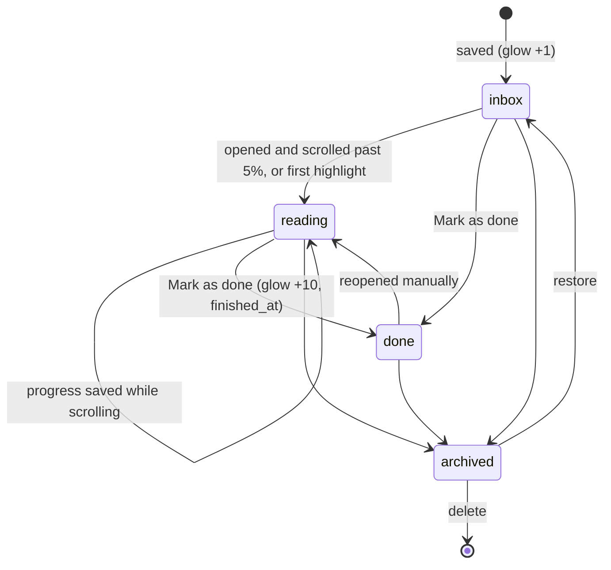
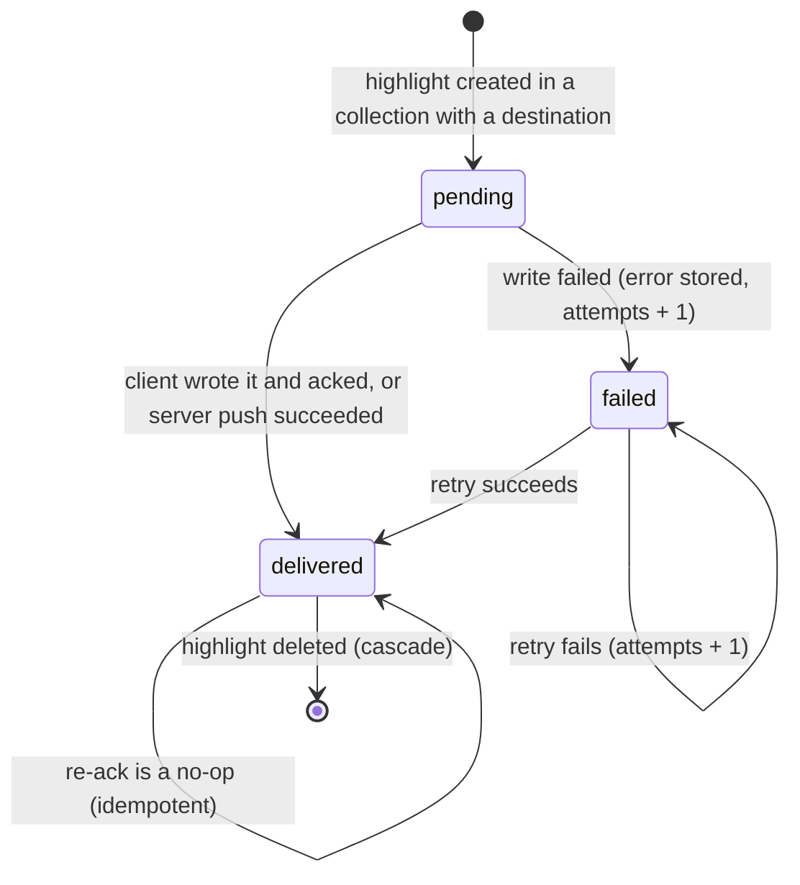
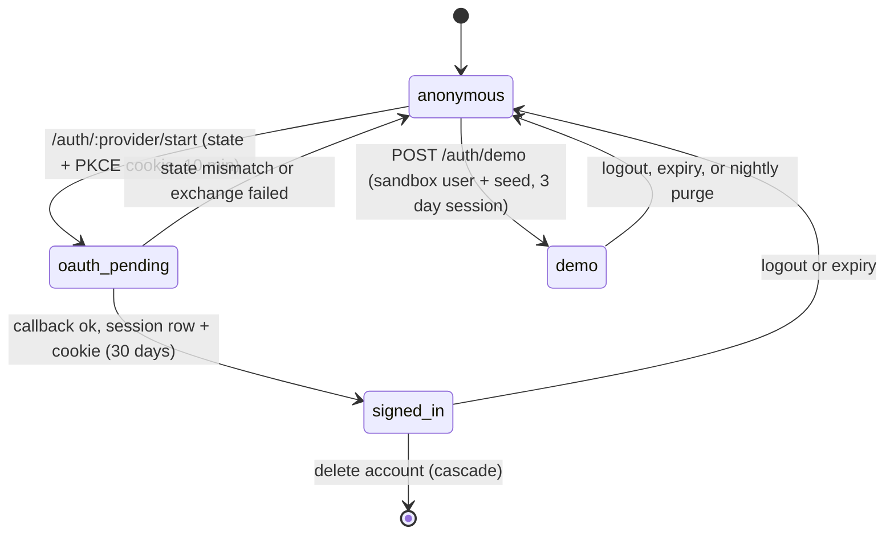
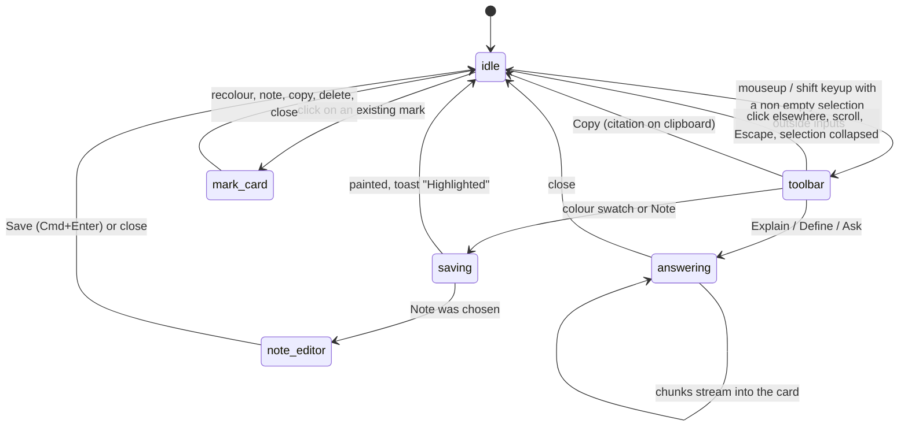
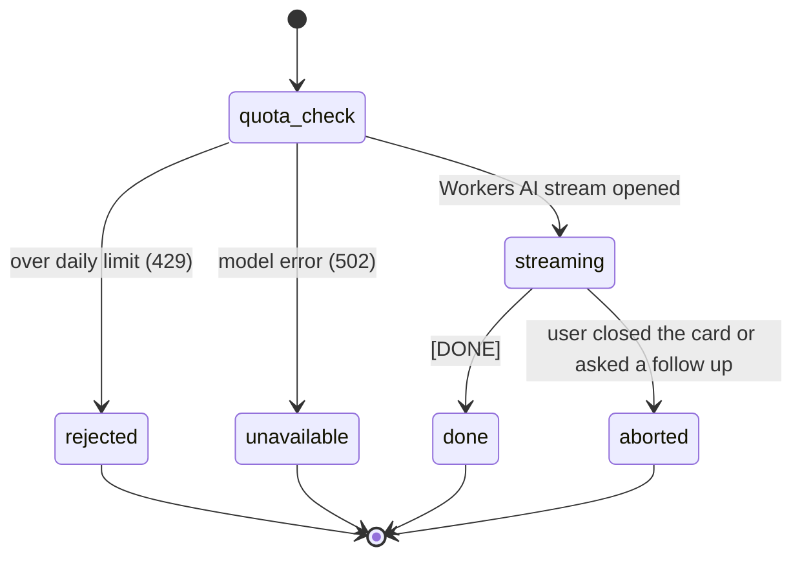
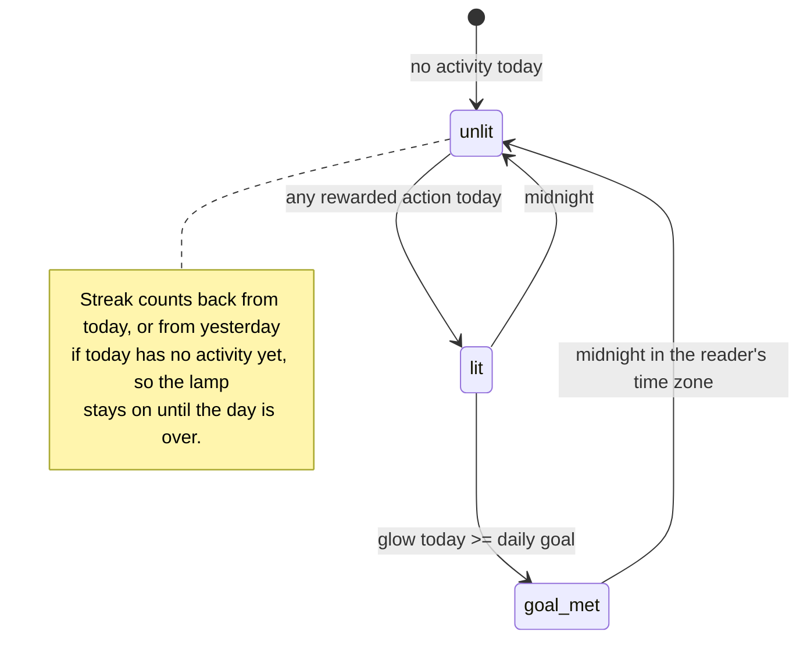

# State diagrams

## Item lifecycle

## Highlight delivery (per destination)
The ledger row is the only state. A highlight with no `delivered` row for a destination is pending.

Moving an item to a collection with a different destination makes its highlights pending for
that destination only; they stay delivered for the old one.

## Session

## Extension selection toolbar

The toolbar never calls `preventDefault` on copy, and pressing a toolbar button prevents only its
own mousedown so the page selection stays alive.

## AI request

## Glow and streak

