# State diagrams

## Item lifecycle
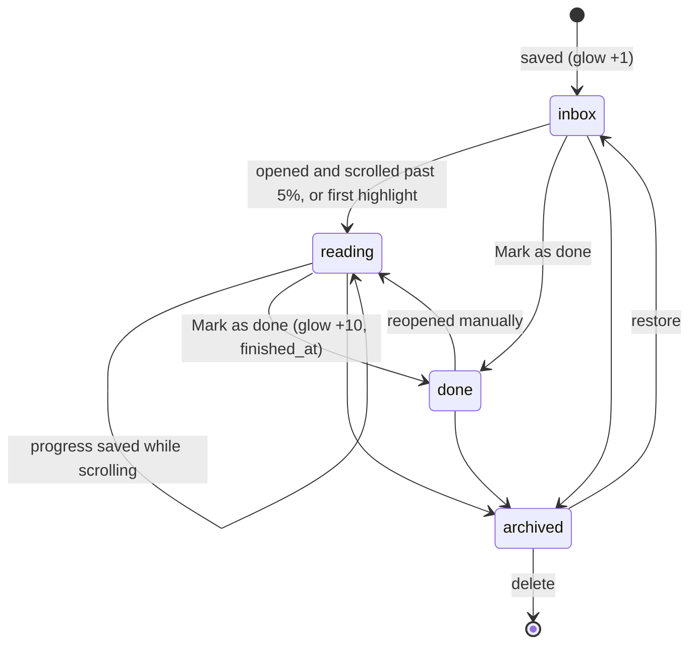

## Highlight delivery (per destination)
The ledger row is the only state. A highlight with no `delivered` row for a destination is pending.
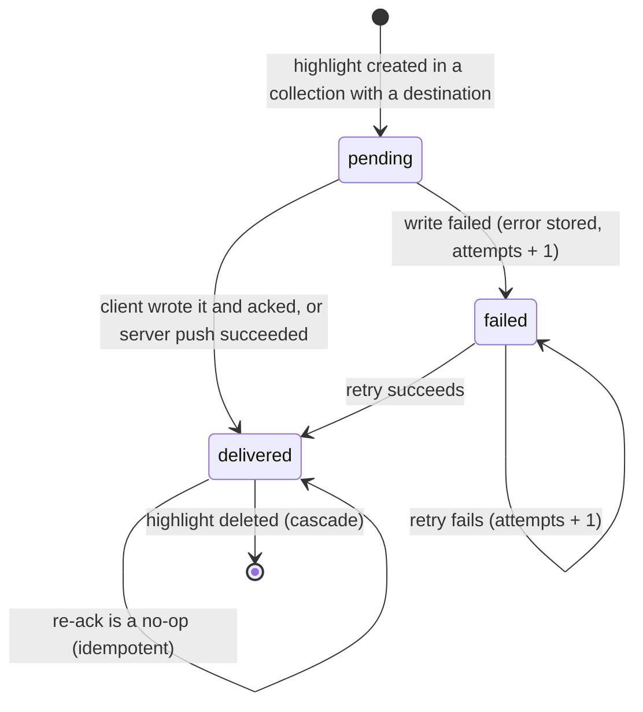
Moving an item to a collection with a different destination makes its highlights pending for
that destination only; they stay delivered for the old one.

## Answer delivery (per destination, LUM-2)
A kept answer reaches each destination once. `answer_deliveries` is the ledger, like `deliveries`
for highlights.
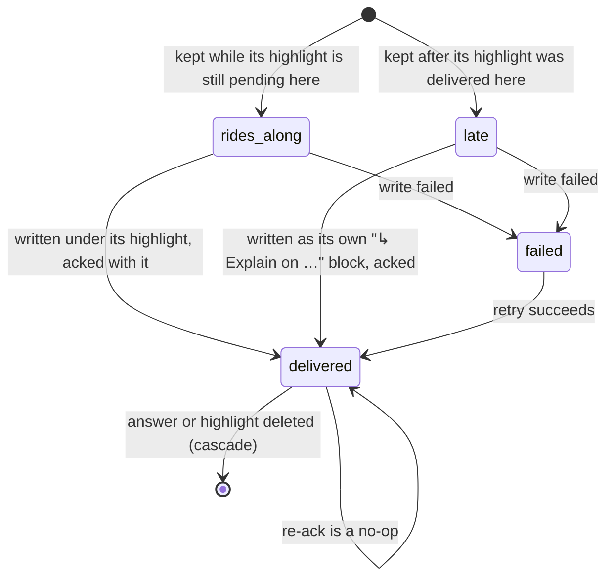
- Highlights written from now on carry a `^lumen-…` block id, so a later version can insert
  late answers in place instead of appending them.
- Clients that only ack highlight ids (extension 2.6 and older) also deliver the answers that
  were kept on those highlights before the ack.

## Margin thread (LUM-2)
A highlight with kept answers is a thread: the passage, the reader's note, then each answer and
its follow ups in order.
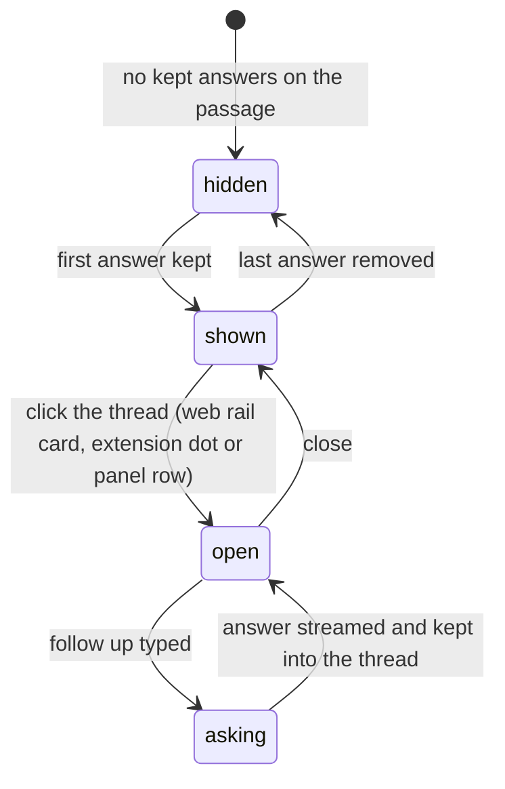
Nothing appears on a page until something is kept there.

## TL;DR (LUM-3)
Only on request, never on save. One per page; keeping a new one replaces the old.
```mermaid
stateDiagram-v2
  [*] --> requested: TL;DR from the page helper, the reader, or /tldr in an Ask box
  requested --> shown: already made this visit (no second call, no second quota use)
  requested --> streaming: paragraphs numbered [p1] … in the prompt only
  streaming --> streaming: over about 40k characters, chunks are summarised first, then combined
  streaming --> shown: done; [p12] becomes a ¶12 link to that paragraph
  streaming --> failed: quota, provider or network error
  shown --> kept: Keep (saves the page first if it is not in the library)
  shown --> gone: page left without keeping
  kept --> delivered: per destination, through its own ledger
```
- Delivered at the top of the source block as `> [!tldr]` when nothing from that page reached the
  destination yet; otherwise as its own block. ¶ links become text fragment links in the note.
- The hosted model counts one answer against the daily quota however many chunks it takes.

## Slash commands in Ask boxes (LUM-3)
| Typed | Does |
|---|---|
| `/tldr` | TL;DR of the page or article |
| `/define [term]` | Define the term, or the passage the box is about |
| `/counter [text]` | Counterpoint to the text, or the passage the box is about |
| `/related [text]` | What in your library relates to it |
Anything else is a normal question.

## Session
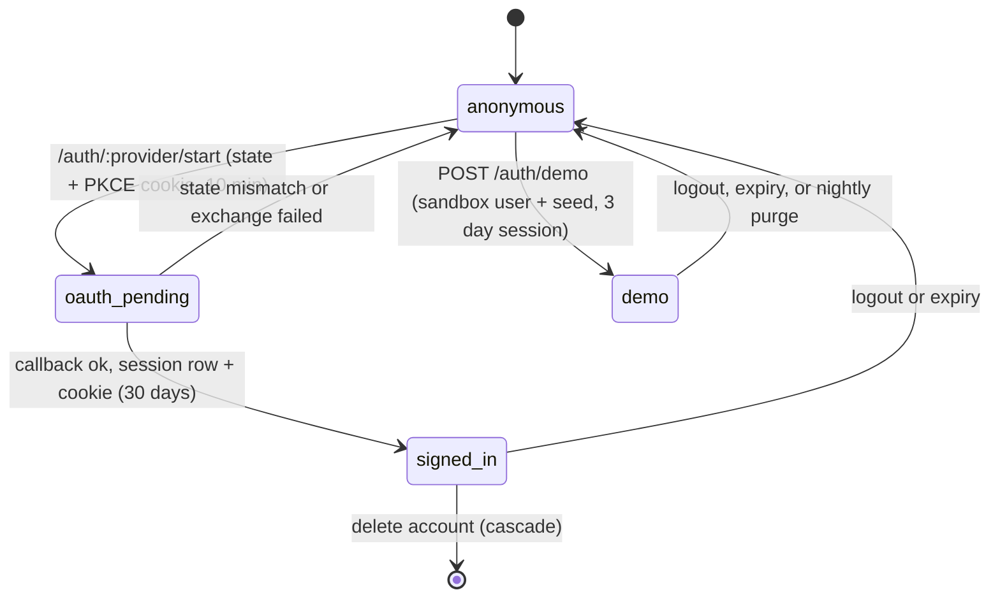

## Selection bar (extension, web reader, landing demo)
One module, `packages/core/src/bar.ts`. It owns its shadow root and only reports what the reader
chose; the host page decides what highlighting, answering or copying means.
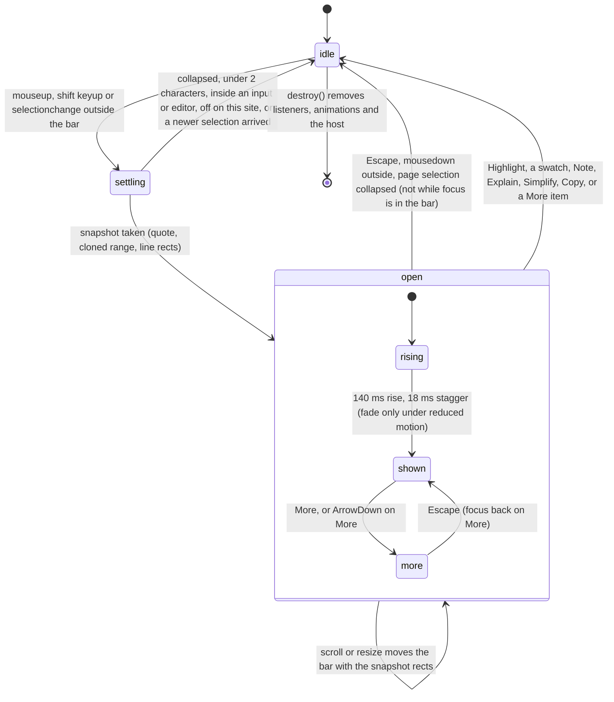
- The bar never calls `preventDefault` on copy. Buttons prevent their own mousedown so the page
  selection stays alive. Ask about this… hands the passage to the panel; the bar has no input.
- Copy puts the plain text on the clipboard; Copy with citation (in More) adds the source link.
- Once open, everything reads from the snapshot, never the live selection, so a later focus
  change or DOM repaint cannot change what an action acts on.
- Keys pressed inside the bar stop at its shadow root, so host shortcuts (YouTube `k`, GitHub `t`)
  do not fire.
- Arrow keys move between the bar's buttons (one Tab stop) and through the open More menu.

## Margin answer
What happens after Explain, Simplify or a More action that answers, on either surface.
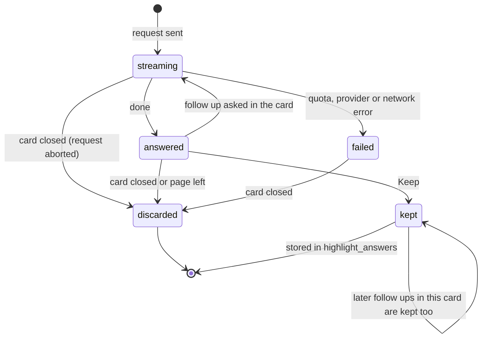
- Keep attaches to the highlight that already covers the passage, otherwise it highlights the
  passage in the last used colour first. The note is never touched; it holds only the reader's words.
- Answers that are not kept live only in the open card.
- A kept answer reaches notes with its highlight when the highlight is still pending for a
  destination. Answers kept after the highlight was delivered wait for answer deliveries (LUM-2).

## Landing demo (LUM-4)
The real selection bar on a sample article in the hero. Answers are written ahead of time for
five terms and a TL;DR; nothing calls a model, needs an account or leaves the page.
```mermaid
stateDiagram-v2
  [*] --> reading
  reading --> bar_open: select text inside the sample article
  bar_open --> reading: Escape, click outside, selection cleared
  bar_open --> marked: Highlight, a swatch, any colour, Save
  bar_open --> reading: Copy or Copy with citation (clipboard)
  bar_open --> answering: Explain, Simplify, Define, Counterpoint or Expand on one of the five terms
  bar_open --> install_prompt: an answering action on other text, or Ask, Related, Note
  reading --> answering: TL;DR on the article
  answering --> answered: the written answer types out (all at once under reduced motion)
  answered --> marked: Keep paints the passage
  answered --> reading: close
  install_prompt --> reading: close
  install_prompt --> [*]: Start free or Add to Chrome
  marked --> reading
```
- A selection counts as a term when it overlaps one of the five underlined terms; the first one wins.
- Marks live only in the page. A reload resets the demo.
- Events go to PostHog only after consent, like the rest of the landing page.

## AI request
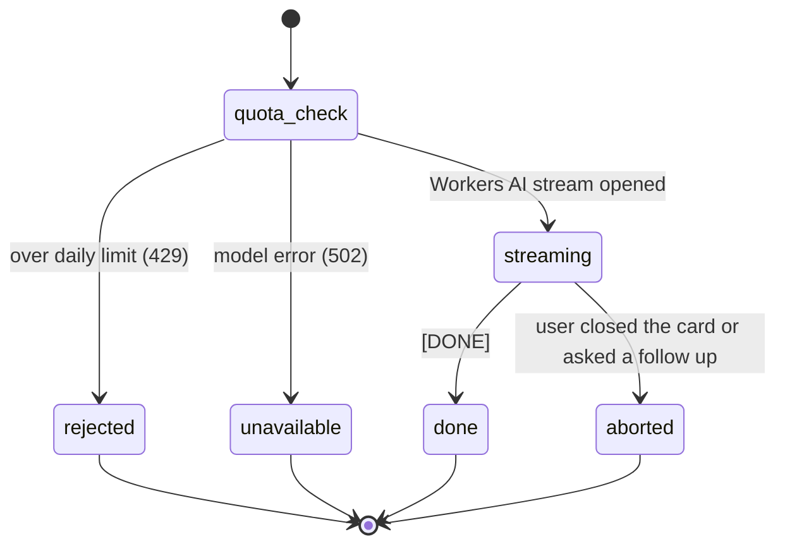

## Glow and streak
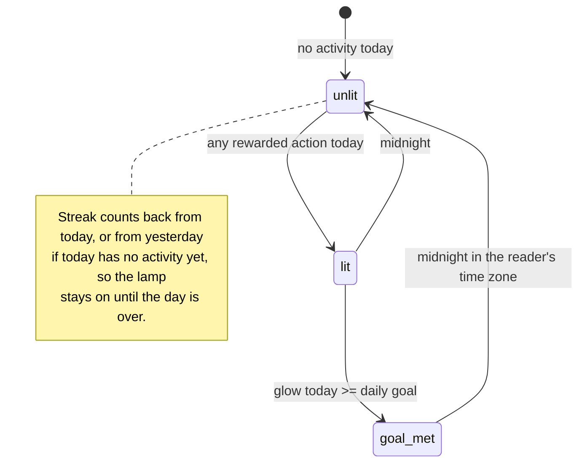
